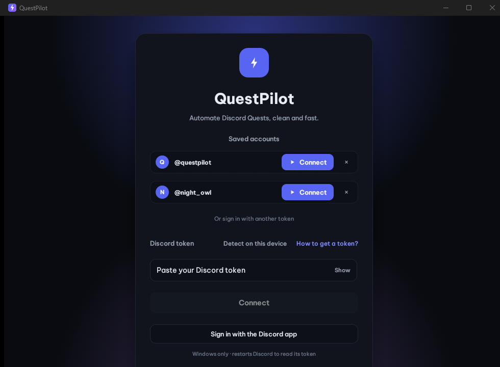
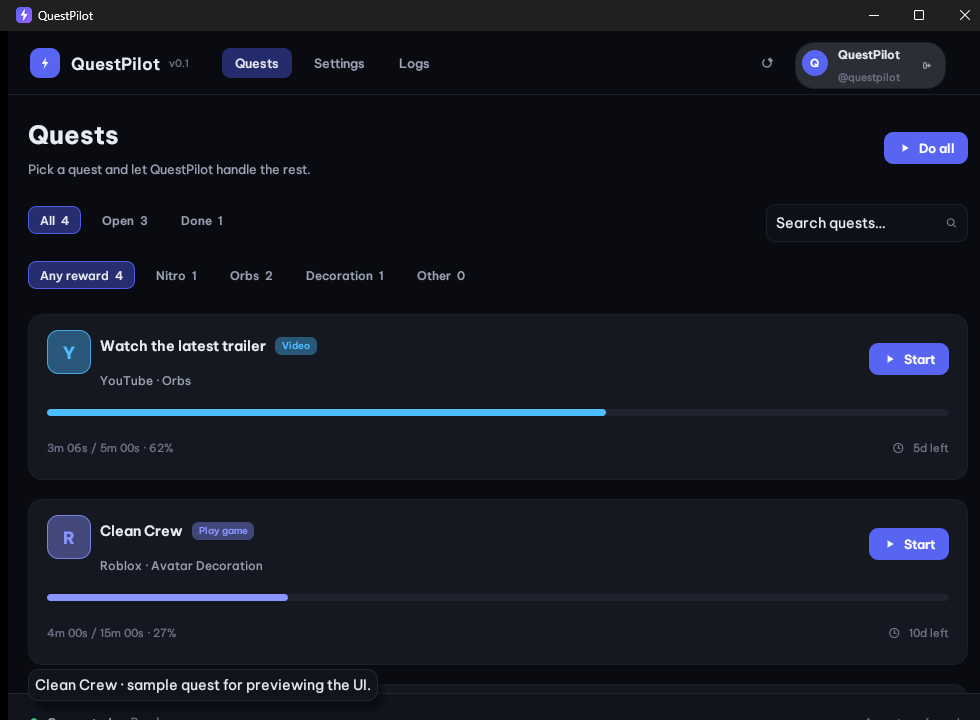
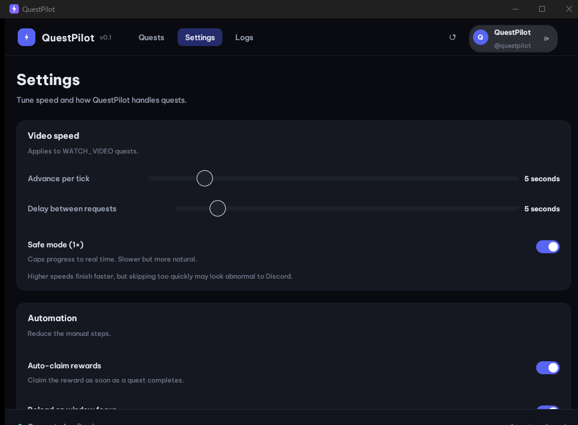

# QuestPilot

Native desktop app (Rust + egui) that completes **Discord Quests** automatically. One `.exe`, embedded
fonts, no WebView.

> ⚠️ **Warning**: automating quests violates Discord's Terms of Service. Your account may lose quest access
> or be suspended. Use at your own risk. Never share your token with anyone.

| Login | Quests |
| --- | --- |
|  |  |

| Settings | Logs |
| --- | --- |
|  |  |

## Install

Packages (`.zip`, `.msi`, `.deb`, `.AppImage`, `.dmg`) are attached to each
[release](https://github.com/Zqw1k/Auto-Discord-Quests/releases). Builds are unsigned, so SmartScreen and
Gatekeeper may warn.

- **Windows** — unzip `questpilot-*-windows-x86_64.zip` and run `questpilot.exe`. The optional `.msi`
  installs for all users and adds a Start Menu shortcut.
- **Linux** — AppImage (`chmod +x`), Debian package (`sudo apt install ./questpilot_*_amd64.deb`) or the
  portable `.tar.gz`. Needs X11/Wayland, `libxkbcommon` and OpenGL; the AppImage may need `libfuse2`.
- **macOS** — open the `.dmg`, drag QuestPilot to Applications, then right-click → Open. Universal build,
  macOS 11+.

## Features

| Quest type | How it completes | |
| --- | --- | --- |
| `WATCH_VIDEO` | `video-progress` requests with increasing timestamps | ✅ |
| `PLAY_ON_DESKTOP` | Valid executable path + fingerprint, real idle runner, heartbeats | ✅ |
| `PLAY_ACTIVITY` | Activity heartbeat, progress read from Discord | ✅ |
| `STREAM_ON_DESKTOP` | Desktop client's stream heartbeat, waits for confirmation | ✅ |
| `ACHIEVEMENT_IN_*` | Only at the end of the real game/activity | ❌ |

- The token stays in RAM: never written to disk, only sent to `discord.com`.
- **Detect on this device** (Windows) decrypts the token Discord already stored. **Sign in with the
  Discord app** reads the live token over a loopback DevTools port. Both run only when you click.
- Saved accounts show the real name, @handle and avatar; signing out asks for confirmation.
- **Do all** queues every open quest, with Stop at any time. Optional auto-claim.
- Filters, search, step-by-step logs, toasts. Expired quests are hidden.
- Progress bars tick every second and settle on Discord's own numbers.
- One window at a time: launching again focuses the existing window.

## Build

Requires stable Rust. `cargo build --release` on Linux/macOS and Windows with Visual Studio Build Tools.

On Windows without Visual Studio, use the GNU toolchain:

```powershell
winget install BrechtSanders.WinLibs.POSIX.UCRT
rustup toolchain install stable-x86_64-pc-windows-gnu
# add ...\WinLibs...\mingw64\bin to PATH
cargo +stable-x86_64-pc-windows-gnu build --release
```

Binary: `target/release/questpilot.exe`.

Demo mode (no token, no network):

```powershell
$env:QUESTPILOT_DEMO = "1"
$env:QUESTPILOT_DEMO_VIEW = "logs"  # quests | empty | settings | logs | help | login | logout
cargo run
```

Debug builds also accept `--detect-tokens`, `--detect-accounts` and `--cdp-signin`.

## Getting your token

**Windows:** click *Detect on this device* (reads the token Discord stored, decrypted with DPAPI) or
*Sign in with the Discord app* (restarts Discord with a loopback DevTools port and reads the live token).
Confirm first; nothing happens at startup.

**Manual:** open Discord, press `Ctrl + Shift + I`, go to **Console** and paste:

```js
(() => { let t; webpackChunkdiscord_app.push([[Symbol()], {}, o => { for (const e of Object.values(o.c ?? {})) { try { const x = e.exports; if (!x || x === window) continue; for (const c of [x, ...Object.values(x)]) { try { const v = c?.getToken?.(); if (typeof v === "string" && v.length > 50 && !/\s/.test(v) && v.split(".").length > 1) { t = v; return; } } catch {} } } catch {} } }]); webpackChunkdiscord_app.pop(); return t })()
```

Copy the printed string. If it prints `undefined`, press `Ctrl + R` and run it again. Alternative:
DevTools → Network → any `discord.com/api` request → `Authorization` header.

## Project layout

```
src/
  main.rs              window setup, single-instance guard, debug flags
  app.rs               UI: login, quest list, settings, logs, toasts
  theme.rs             tokens, fonts, vector icons
  models.rs            Discord quest/user JSON
  config.rs            settings in QuestPilot/settings.json
  worker.rs            tokio worker: login, refresh, execution, queue
  discord/
    api.rs             REST client
    fingerprint.rs     executable fingerprint
    token.rs           local token detection (Windows, DPAPI)
    cdp.rs             DevTools sign-in (Windows)
.github/workflows/     CI and release packaging
packaging/ wix/        Linux/macOS/Windows package files
scripts/shot.ps1       window screenshots
```

## No quests showing?

- **Logs** shows what Discord returned (`Loaded … quests (… available, … raw entries)`).
- `… excluded quests` means your account or region is not eligible; a VPN won't change that.
- `HTTP 401` means the token expired — sign in again.
- Network errors: check that `discord.com` is reachable (VPN/proxy may block it).

## Technical notes

- **Video**: increasing `timestamp` every 2–30 s (speed 1–30×); safe mode caps progress to real time.
- **Game**: builds a valid `executable_path` and 146-byte fingerprint from app metadata and starts a real
  idle `questpilot --game-runner` process that dies with the app. Heartbeats are ≤60 s apart, completion is
  decided by Discord's own progress, and a terminal heartbeat always closes the session.
- **Activity / stream**: same heartbeat loop; stream sends fresh `stream_<32>` keys every ~30 s and fails
  fast if Discord is not crediting them.
- **One window**: a named mutex; **Stop** cancels the worker and kills the runner immediately.
- Requests carry `x-super-properties`, the Discord referer and UA; 429 is retried once; delays carry jitter.

## License

MIT.
