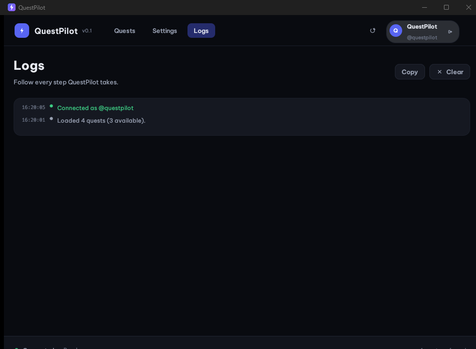

# QuestPilot

A compact desktop app (Rust + egui) that completes **Discord Quests** automatically — same mechanism as
[Masterain98/discord-quest-helper](https://github.com/Masterain98/discord-quest-helper), but without
Tauri/WebView: the backend and UI live in a single `.exe` (fonts embedded).

> ⚠️ **Warning**: Automating quests violates Discord's Terms of Service. Your account may lose quest access
> or be suspended. Use at your own risk. Never share your token with anyone.

| Login | Quests |
| --- | --- |
|  |  |

| Settings | Logs |
| --- | --- |
|  |  |

## Features

| Quest type | How it works | Status |
| --- | --- | --- |
| `WATCH_VIDEO` | `POST /quests/{id}/video-progress` at timestamp steps with slight jitter | ✅ |
| `PLAY_ON_DESKTOP` | Fetches app metadata → builds a valid `executable_path` + `executable_fingerprint` → heartbeat every 60s | ✅ |
| `PLAY_ACTIVITY` | Activity heartbeat, reads progress from Discord's response | ✅ |
| `STREAM_ON_DESKTOP` | Discord requires a real stream with viewers in the voice channel | ❌ |
| `ACHIEVEMENT_IN_*` | Must be unlocked inside the actual game/activity | ❌ |

- Sign in by pasting your token; the token **stays in RAM**, is never written to disk and is never sent
  anywhere except `discord.com`.
- **Do all**: queues open quests and runs them one by one; you can stop at any time.
- Auto-claim rewards on completion (optional), refresh the list when you return to the window.
- Filters (All / Open / Done), search, step-by-step logs, toast notifications.
- Expired quests are hidden automatically.
- Dark UI, Be Vietnam Pro font, hand-drawn vector icons, no external image dependencies.

## Build

Requires stable Rust. Two options on Windows:

**Option 1 — MSVC (standard, requires Visual Studio Build Tools)**

Install *Build Tools for Visual Studio* with the **Desktop development with C++** workload, then:

```powershell
cargo build --release
```

**Option 2 — GNU (lightweight, no Visual Studio)**

```powershell
winget install BrechtSanders.WinLibs.POSIX.UCRT
rustup toolchain install stable-x86_64-pc-windows-gnu
```

Add `...\WinLibs...\mingw64\bin` to `PATH`, then:

```powershell
cargo +stable-x86_64-pc-windows-gnu build --release
```

Binary: `target/release/questpilot.exe`.

### Demo mode

Build debug and run with sample data (no token, no network):

```powershell
$env:QUESTPILOT_DEMO = "1"          # enable sample data
$env:QUESTPILOT_DEMO_VIEW = "logs"  # quests | empty | settings | logs | help
cargo run
```

## Getting your token

**Option 1 — Discord desktop**

1. Open Discord desktop and press `Ctrl + Shift + I`.
2. Switch to the **Console** tab, paste the snippet below, then press Enter:

```js
(() => { let t; webpackChunkdiscord_app.push([[Symbol()], {}, o => { for (const e of Object.values(o.c ?? {})) { try { const x = e.exports; if (!x || x === window) continue; for (const c of [x, ...Object.values(x)]) { try { const v = c?.getToken?.(); if (typeof v === "string" && v.length > 50 && !/\s/.test(v) && v.split(".").length > 1) { t = v; return; } } catch {} } } catch {} } }]); webpackChunkdiscord_app.pop(); return t })()
```

3. Copy the string it prints and paste it into QuestPilot.
4. If it prints `undefined` or an object, press `Ctrl + R` in Discord and run the snippet again.

**Option 2 — Network tab**

DevTools → Network → select a request to `discord.com/api` → check the `Authorization` header.

## Project layout

```
src/
  main.rs              creates the egui window
  app.rs               UI: login, quest list, settings, logs, toasts
  theme.rs             design tokens, Be Vietnam Pro font, vector icons, gradients
  models.rs            parses Discord quest JSON into compact models
  config.rs            settings stored at %APPDATA%\QuestPilot\settings.json
  worker.rs            tokio worker: login, refresh, quest execution, queue, events
  discord/
    api.rs             REST client (quests, enroll, video-progress, heartbeat, claim)
    fingerprint.rs     rebuilds the 146-byte / 196-char base64 executable fingerprint
assets/fonts/          Be Vietnam Pro (OFL)
scripts/shot.ps1       captures the app window (used for README screenshots)
docs/screenshots/      UI screenshots
```

## No quests showing?

1. Open the **Logs** tab — the `Loaded … quests (… available, … raw entries)` line shows what Discord actually returned.
2. If the list is empty and you see `… excluded quests`, your account/region is not eligible for those quests.
   Discord limits quests by country and age; a VPN won't help because eligibility is tied to the account.
3. If you see `HTTP 401`, the token is expired or invalid — sign out and get a new token.
4. On network errors, check connectivity to `discord.com` (a VPN/proxy may block it).
5. The **Reload** button on the empty state re-calls the API immediately.

While testing the UI, you can preview the empty state with
`$env:QUESTPILOT_DEMO_VIEW = "empty"`.

## Technical notes

- **Video**: each request sends an increasing `timestamp` (seconds); Discord returns `completed_at` when done.
  Speed and delay are configured in **Settings** (1×–30×, 2–30 seconds). **Safe mode** caps progress to real time.
- **Game**: `executable_path` is trimmed to its last two segments (matching Discord's normalization); the
  fingerprint is a 146-byte structure (PE header + hardware hash + section + signature) XORed with SHA-256
  of `user_id` + salt, then base64-encoded — the same format the desktop client sends in its heartbeat.
- **Activity**: 60-second heartbeat, progress read from `progress.PLAY_ACTIVITY.value`.
- Every request includes `x-super-properties`, `referer: https://discord.com/quest-home` and the Discord
  client UA; 429 responses are retried once.

## License

MIT. The fingerprint reverse-engineering part is based on public documentation from the
`discord-quest-helper` project (MIT).
